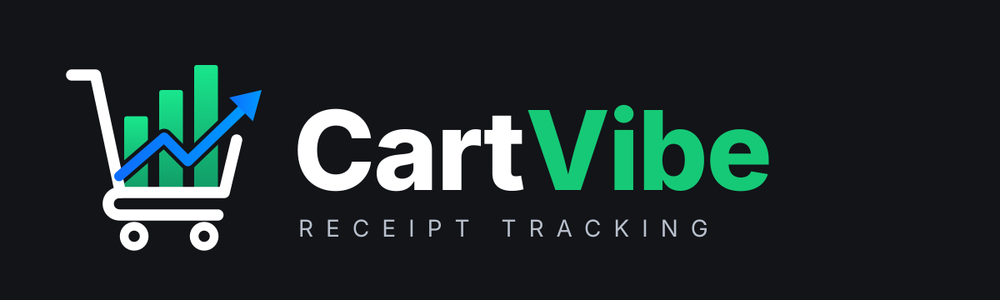
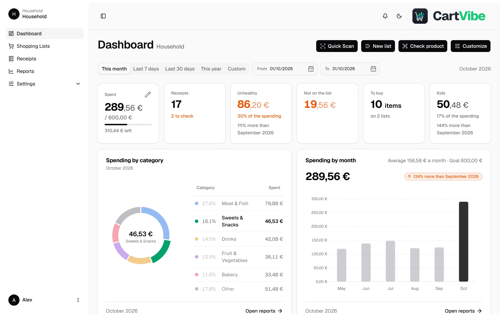
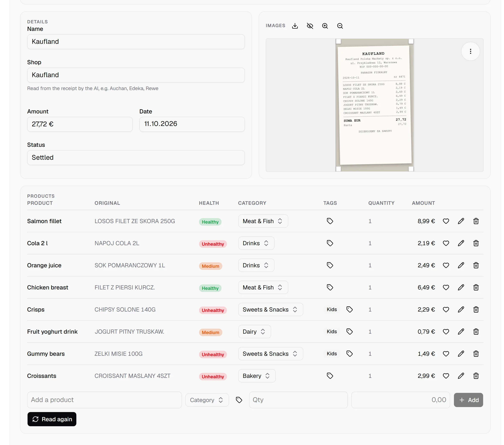
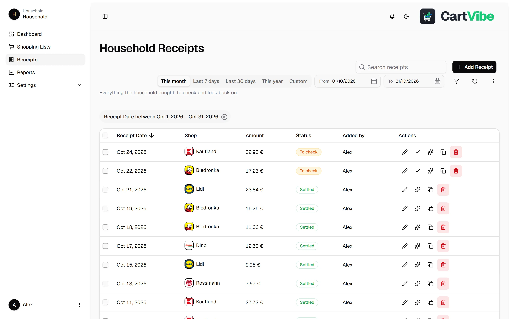

<div align="center">



**CartVibe is a self-hosted household app for receipts, shopping lists, and spending insights.**

[](https://github.com/wouekk/cartvibe/releases)
[](LICENSE)
[](https://github.com/wouekk/cartvibe/actions/workflows/ci.yml)
[](https://github.com/wouekk/cartvibe/pkgs/container/cartvibe)

[Project page](https://cartvibe.app/) · [Quick start](#quick-start) · [Synology guide](#on-a-synology-nas-container-manager-or-dockhand) · [API keys](#getting-your-api-keys) · [Changelog](CHANGELOG.md) · [Credits](NOTICE.md) · [Issues](https://github.com/wouekk/cartvibe/issues)

</div>

---

> [!NOTE]
> **Credits.** CartVibe is a fork of [Receipt Wrangler](https://github.com/Receipt-Wrangler/receipt-wrangler) by
> [Noah Hall (@Noah231515)](https://github.com/Noah231515) and contributors, licensed under the AGPL-3.0.
> This fork is a **vibe-coded** personal project: its changes were written with an
> AI assistant and are maintained by me for my household as a hobby project. Not affiliated with the original authors.
> Details in [NOTICE.md](NOTICE.md).

Would rather not run a server? **CartVibe for iPhone** is on its way to the App Store. It is a separate app: your data stays
on the phone, or in your own iCloud if you turn on sync, and it does not connect to a self-hosted CartVibe. You can follow its progress
in [issue #1](https://github.com/wouekk/cartvibe/issues/1).

## Quick start

All you need is [Docker](https://docs.docker.com/get-docker/) with Docker Compose, or a NAS stack manager such as
Dockhand or Synology's Container Manager. There is nothing to build: GitHub publishes a ready-made image at
`ghcr.io/wouekk/cartvibe` (`:latest` is the current release, `:preview` is the version being tested).

### 1. Make a folder and save this as `docker-compose.yml`

```yaml
services:
  cartvibe:
    image: ghcr.io/wouekk/cartvibe:latest
    pull_policy: always              # every `docker compose up` checks for a newer image
    restart: unless-stopped
    depends_on:
      valkey:
        condition: service_healthy
    ports:
      - "8091:80"                    # open CartVibe at http://<your-server>:8091
    environment:
      - TZ=Europe/Paris              # your time zone
      - SECRET_KEY=${SECRET_KEY}     # both come from the .env file in step 2
      - ENCRYPTION_KEY=${ENCRYPTION_KEY}
      - DB_ENGINE=sqlite
      - DB_FILENAME=app.db           # keep this name, or the app starts with an empty database
      - PUID=${PUID:-}               # optional: the user and group that own the three folders below
      - PGID=${PGID:-}               # (recommended on a Synology, see "On a Synology NAS" below)
    volumes:
      - ./sqlite:/app/cartvibe-api/sqlite   # the database
      - ./data:/app/cartvibe-api/data       # receipt photos
      - ./logs:/app/cartvibe-api/logs

  valkey:                            # background jobs (AI reads, clean-up) queue here
    image: valkey/valkey:9.1-alpine
    restart: unless-stopped
    command: ["valkey-server", "--appendonly", "yes"]
    healthcheck:
      test: ["CMD", "valkey-cli", "ping"]
      interval: 10s
      timeout: 3s
      retries: 5
    volumes:
      - valkey-data:/data

volumes:
  valkey-data:
```

### 2. Add your two keys

Next to `docker-compose.yml`, create a file called `.env` with two long random keys. Use letters and digits only: Compose treats a `$`
as the start of a variable and silently drops it.

```bash
printf 'SECRET_KEY=%s\nENCRYPTION_KEY=%s\n' "$(openssl rand -hex 32)" "$(openssl rand -hex 32)" > .env
```

* **`SECRET_KEY`** signs your login cookies and tokens so sessions cannot be forged. If you change it later, everyone is simply logged out and has to sign back in.
* **`ENCRYPTION_KEY`** encrypts the secrets you save in the app: the AI API keys, the Logo.dev key, and any sign-in provider secret. **Keep it safe and never change it.** With a new key CartVibe can no longer read what is already stored, and you would have to enter all of those keys again. Passwords are not affected: they are stored as one-way hashes.

Keep the `.env` file somewhere safe too, and include it in your backups: without the original `ENCRYPTION_KEY` the saved keys cannot be recovered.

### 3. Start it

```bash
docker compose up -d
```

Open `http://<your-server>:8091` and sign in with `admin` / `admin`, then **change that password straight away**.
The welcome screen asks for your language, theme, and currency, and the AI page is where you add a Claude, Gemini, or
ChatGPT key (or a local model at home) so receipts can be read. [Getting your API keys](#getting-your-api-keys) shows where to create
one and which cheap model to choose.

### Updating

```bash
docker compose pull && docker compose up -d
```

Then hard-refresh the browser. Before updating to a release whose [changelog](CHANGELOG.md) mentions a database change, back up
first: stop the stack (`docker compose stop`), copy the whole `sqlite` folder somewhere safe (it holds `app.db` plus its `-wal`
and `-shm` files, and all three belong together), then start it again.

### On a Synology NAS (Container Manager or Dockhand)

The stack above runs on a Synology as it is. Three things need care: the folders must exist before the first start, the container should
run as the DSM user who owns them, and an update has to pull the new image explicitly. The annotated stack this project runs itself is
[docker-compose.yml](docker-compose.yml).

1. **Create the folders first.** In **File Station**, open the `docker` shared folder (if you do not have one, create it under
   **Control Panel** > **Shared Folder**) and create `cartvibe` inside it, with three subfolders:
   * `/docker/cartvibe/sqlite`
   * `/docker/cartvibe/data`
   * `/docker/cartvibe/logs`

   On the NAS itself these live under the volume's name, for example `/volume1/docker/cartvibe/sqlite` (it can be `volume2` or another).
2. **Find the `PUID` and `PGID` of the DSM user who owns those folders** (normally the account you created them with). They are
   optional, but without them DSM's folder permissions may refuse the container's built-in user. CartVibe then still starts, runs as
   root, and logs a warning (see Troubleshooting).
   * **Via SSH:** Turn it on under **Control Panel** > **Terminal & SNMP**, log in, and run `id <your-dsm-user>`. The answer looks like `uid=1026(…) gid=100(users)`:
     `1026` is the `PUID` and `100` the `PGID`.
   * **Without SSH:** Open **Control Panel** > **Task Scheduler** and click **Create** > **Scheduled Task** > **User-defined script**.
     On the **General** tab, name it `Find ID` and set **User** to your DSM user (the default, `root`, would answer `uid=0`).
     On **Task Settings**, type `id` in the script box and turn on **Save output results** (or email notifications) if offered. Click **OK**,
     select the task, choose **Run**, then **Action** > **View Result**. Delete the task afterwards.

   The first account you create on a Synology is usually `1026` / `100`, but check yours.
3. **Create the stack.**
   * **Container Manager:** Under **Project**, click **Create**, name it `cartvibe`, and choose `/docker/cartvibe` as the path. Paste the YAML from step 1.
     The project folder is where `./sqlite`, `./data`, and `./logs` point, so those lines work unchanged.
   * **Dockhand:** Paste the YAML as a new stack and replace the three left-hand paths with the full ones:
     `/volume1/docker/cartvibe/sqlite`, `/volume1/docker/cartvibe/data`, and `/volume1/docker/cartvibe/logs`.
4. **Set the variables:** `SECRET_KEY`, `ENCRYPTION_KEY`, `PUID`, and `PGID`.
   * **Dockhand:** Add them in the stack's environment variables.
   * **Container Manager:** Put them in a `.env` file next to the YAML. Over SSH:

     ```bash
     cd /volume1/docker/cartvibe
     printf 'SECRET_KEY=%s\nENCRYPTION_KEY=%s\nPUID=1026\nPGID=100\n' "$(openssl rand -hex 32)" "$(openssl rand -hex 32)" > .env
     ```

   Replace `1026` and `100` with your own values from step 2. Keep the keys to letters and digits (no `$`), as in step 2 of the Quick start.
5. **Start it and open** `http://<your-nas>:8091`, then sign in as in step 3 of the Quick start. If something else already uses port 8091, change the left-hand
   number in `ports`.

**Updating on a Synology.** Pull the new image first, then redeploy: a plain redeploy in a stack manager can reuse the image it already has.
In Dockhand, pull and then redeploy the stack. Over SSH:

```bash
cd /volume1/docker/cartvibe
sudo docker compose pull && sudo docker compose up -d
```

Then hard-refresh the browser. Back up as described under [Updating](#updating) first when a release changes the database. Hyper Backup can
back up the `docker` shared folder on a schedule, but stop the stack for a moment before a copy you mean to restore from, so the database files match.

**Troubleshooting**

* **The log says a folder "is not writable … so the API runs as root".** DSM's permissions refused the container's default user. Set `PUID` and `PGID` to the user who owns the
  folders (step 2) and redeploy.
* **The page does not load.** Check that both `cartvibe` and `valkey` are running, and that the port in `ports` is free. CartVibe waits for Valkey to be healthy
  before it starts.
* **You start with an empty database after an update.** `DB_FILENAME` must still be `app.db`, and `./sqlite` must still point at the same folder.

## Getting your API keys

CartVibe only needs an API key for two optional things: the AI that reads your receipts, and shop logos. You create the key on the provider's
website, then paste it into CartVibe. Each link goes straight to the provider's keys page; it asks you to sign in first.

| Provider | Create the key here | Paste it in CartVibe |
| :--- | :--- | :--- |
| **Claude** (Anthropic) | [platform.claude.com/settings/keys](https://platform.claude.com/settings/keys) | **AI** page, provider **Claude** |
| **Gemini** (Google) | [aistudio.google.com/apikey](https://aistudio.google.com/apikey) | **AI** page, provider **Gemini** |
| **ChatGPT** (OpenAI) | [platform.openai.com/api-keys](https://platform.openai.com/api-keys) | **AI** page, provider **ChatGPT** |
| **Logo.dev** (shop logos) | [logo.dev/dashboard/api-keys](https://www.logo.dev/dashboard/api-keys) | **System Settings**, **Shop logos** card |

A model you run yourself (**Local LM**, such as LM Studio or Ollama) needs no key from these sites: choose it on the same **AI** page and enter its address.

### Step by step

* **Claude:** Open the link and sign in (or create a Claude Console account). Click **Create key**, give it a name such as `cartvibe`, and pick an
  expiration. Choose a long one or **Never**, because an expired key quietly stops the receipt reading. Copy the key straight away: it is shown only once.
  A Claude chat subscription does not include the API; API use is billed separately in the Console.
* **Gemini:** Open the link and sign in with a Google account. Click **Create API key** and choose a Google Cloud project when it asks.
  Copy the key. You can view it again later on the same page. Read Google's data-use terms for the free tier before you send family receipts through it.
* **ChatGPT (OpenAI):** Open the link, sign in, and click **Create new secret key**. Name it, pick a project, and leave the permissions on **All**. Copy the key now: it is
  shown only once. A ChatGPT subscription does not include the API; add credit under **Billing** in the OpenAI dashboard first.
* **Logo.dev:** Sign up, open the link, and copy the **secret key**. It starts with `sk_`; the publishable `pk_` key will not work. There is a free plan, and CartVibe then shows
  "Logos provided by Logo.dev" on the login page.

Then sign in to CartVibe as an admin, open the **AI** page, choose the provider, paste the key, pick a model (see below), and press **Test connection**.
CartVibe stores the key encrypted with your `ENCRYPTION_KEY`, so it never goes in `docker-compose.yml` or `.env`.

### Which model to pick (the cheapest that works)

Reading a receipt is a small job: one photo in, a short list of lines out, a few thousand tokens in total. The small models are enough, and a receipt typically costs well under a cent.
The cheapest picks below accept photos.

| Provider | Cheapest good pick (enter this model) | Price per million tokens, input / output | A step up if lines are misread |
| :--- | :--- | :--- | :--- |
| **Gemini** | `gemini-3.5-flash-lite` (stable, has a free tier) | $0.30 / $2.50 | `gemini-3.8-flash`: $0.75 / $3.75 until 31 Dec 2026, then $1.50 / $7.50 |
| **Claude** | `claude-haiku-5-5` | $0.10 / $0.50 | `claude-sonnet-5-5`: $2 / $10 |
| **ChatGPT** | `gpt-6-luna` | $0.10 / $0.50 | `gpt-5.4-mini`: $0.75 / $4.50 |

* **You choose the model.** CartVibe does not pre-select one: the Model box stays empty until you pick, because models are billed by the token at very different prices
  (Claude Opus costs about 40 times as much as Haiku). For Gemini, pick a current model from the table: Google lists the older 2.5 models as available only to accounts
  that already used them, so a new key may be refused on them.
* **Names change.** `gemini-3.5-flash` no longer exists; Google's current small models are the **Flash-Lite** ones. Prices and names were checked on 2 November 2026,
  so compare them with the provider's own list before you settle: [Gemini](https://ai.google.dev/gemini-api/docs/pricing) ·
  [Claude](https://platform.claude.com/docs/en/about-claude/pricing) · [OpenAI](https://developers.openai.com/api/docs/pricing).
* **Test before you trust it.** Scan three or four real receipts with the cheap model and check the lines. If it misreads them, move one step up; do not jump to the biggest model.
* **Keep keys private and capped.** A key is a password that spends your money. Do not post it or commit it, set a monthly spending limit in the provider's console if it
  offers one, and delete the key on the same page if it ever leaks.

## Features

The same tour, with screenshots and a live demo, is on [cartvibe.app](https://cartvibe.app/).

| Feature | What it does |
| :--- | :--- |
| **Live shared shopping lists** | Build the list on your phone in the shop. What you add shows on every phone in the family; cross things off as you go and mark the trip done. |
| **Receipt line scanning** | Upload a photo or a PDF and every line is read out. Money is kept as exact decimals, so the lines add up to the cent and any mismatch is flagged. |
| **Optional AI labels** | With an AI key (Claude, Gemini, ChatGPT, or a local model via LM Studio or Ollama), each line gets a category, a health rating, and a planned or not-on-the-list flag. If the AI is down, nothing fails, and it never assigns your tags. |
| **Household overview and goals** | One Dashboard for groceries, eating out, transport, travel, leisure, and bills, with a monthly goal you can watch fill up. |
| **Warranties** | Add a warranty date to a receipt and see what is still covered, nearest expiry first, with optional reminders. |
| **Reports** | Build a report by category, shop, or month with a live preview, and export it to PDF, CSV, or Excel. |
| **Barcode scanner** | Scan or type a barcode to see the Nutri-Score, NOVA level, additives, and nutrition from Open Food Facts. |
| **Installs like an app** | Phone-first: add it to your home screen and it opens full-screen, keeping the display awake while you shop. |
| **Other** | Shop logos (with your own free Logo.dev key), light and dark modes with four accent palettes, five languages (English and Polish checked by hand), custom tags, multiple currencies, family accounts, `Ctrl`/`Cmd + K` search, and reminders. |

<p align="center">
  <picture>
    <source media="(prefers-color-scheme: dark)" srcset="docs/screenshots/dashboard-dark.webp" />
    
  </picture>
  <br />
  <sub><b>The family Dashboard</b>: what you've spent this month, how close you are to your budget, what wasn't on the list, and where the money went</sub>
</p>

<!-- The two receipt shots have different shapes (nearly square and 16:10), so both get the same height and line up. -->
<table>
  <tr>
    <td width="50%" valign="top" align="center">
      
      <p align="center"><sub><b>Receipts read by AI</b>: every line from the photo, with a health rating and a category</sub></p>
    </td>
    <td width="50%" valign="top" align="center">
      
      <p align="center"><sub><b>Receipts</b>: optional shop logos, a search that forgives typos, and one date picker</sub></p>
    </td>
  </tr>
</table>

<sub>Screenshots show demo data.</sub>

## Repository layout

| Folder | What |
|---|---|
| `api/` | Go backend (Chi router, GORM, Asynq background workers on Valkey) |
| `desktop/` | Angular web app, installable as a PWA and built for phones first |
| `docker/` | One production image: nginx serves the app and proxies the Go API |
| `docs/` | Developer setup, the AI prompts, themes, and these screenshots |
| `site/` | The project page (static Astro site, see [docs/site.md](docs/site.md)) |

Working notes for contributors and AI agents: [CLAUDE.md](CLAUDE.md), [AGENTS.md](AGENTS.md), [DESIGN.md](DESIGN.md), [docs/dev-setup.md](docs/dev-setup.md).

## Versions

[Semantic Versioning](https://semver.org/). Changes are listed in [CHANGELOG.md](CHANGELOG.md); releases are tags
`vMAJOR.MINOR.PATCH` on `main`. Commit messages follow [Conventional Commits](https://www.conventionalcommits.org/).

## Licence

GNU Affero General Public License v3.0, as the original ([LICENSE](LICENSE)). If you run a modified copy as a
service, you must offer its users the source.
