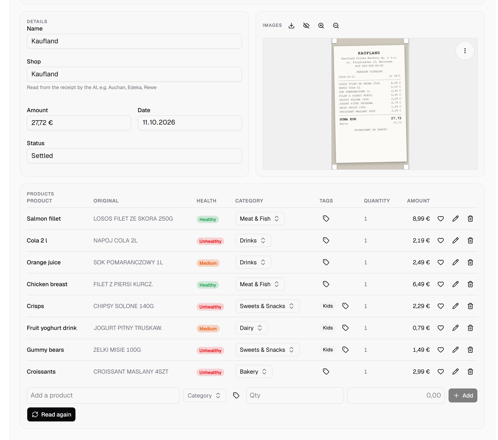
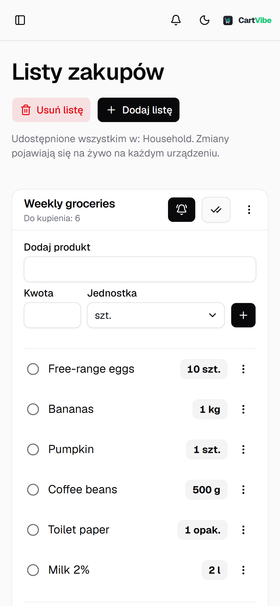

<div align="center">


**CartVibe is a self-hosted household app for receipts, shopping lists and spending insights.**

[](https://github.com/wouekk/cartvibe/releases)
[](LICENSE)
[](https://github.com/wouekk/cartvibe/actions/workflows/ci.yml)
[](https://github.com/wouekk/cartvibe/pkgs/container/cartvibe)

[Project page](https://wouekk.github.io/cartvibe/) · [Quick start](#quick-start) · [Changelog](CHANGELOG.md) · [Credits](NOTICE.md) · [Issues](https://github.com/wouekk/cartvibe/issues)

</div>

---

> [!NOTE]
> **Credits.** CartVibe is a fork of [Receipt Wrangler](https://github.com/Receipt-Wrangler/receipt-wrangler) by
> [Noah Hall (@Noah231515)](https://github.com/Noah231515) and contributors, licensed under the AGPL-3.0. 
> This fork is a **vibe-coded** personal project: its changes were written with an
> AI assistant and are maintained by me for my household as a hobby project. Not affiliated with the original authors.
> Details in [NOTICE.md](NOTICE.md).

## Quick start

All you need is [Docker](https://docs.docker.com/get-docker/) with Docker Compose, or a NAS stack manager such as
Dockhand or Synology's Container Manager. There is nothing to build: GitHub publishes a ready-made image,
`ghcr.io/wouekk/cartvibe` (`:latest` is the current release, `:preview` the version being tried out).

### 1. Make a folder and save this as `docker-compose.yml`

```yaml
services:
  cartvibe:
    image: ghcr.io/wouekk/cartvibe:latest
    pull_policy: always              # every deploy checks for a newer image
    restart: unless-stopped
    depends_on:
      redis:
        condition: service_healthy
    ports:
      - "8091:80"                    # open CartVibe at http://<your-server>:8091
    environment:
      - TZ=Europe/Paris              # your time zone
      - SECRET_KEY=${SECRET_KEY}     # both come from the .env file in step 2
      - ENCRYPTION_KEY=${ENCRYPTION_KEY}
      - DB_ENGINE=sqlite
      - DB_FILENAME=app.db           # keep this name, or the app starts with an empty database
      - REDIS_HOST=redis
      - REDIS_PORT=6379
    volumes:
      - ./sqlite:/app/cartvibe-api/sqlite   # the database
      - ./data:/app/cartvibe-api/data       # receipt photos
      - ./logs:/app/cartvibe-api/logs

  redis:                             # background jobs (AI reads, clean-up) queue here
    image: redis:7.4-alpine
    restart: unless-stopped
    command: ["redis-server", "--appendonly", "yes"]
    healthcheck:
      test: ["CMD", "redis-cli", "ping"]
      interval: 10s
      timeout: 3s
      retries: 5
    volumes:
      - redis-data:/data

volumes:
  redis-data:
```

### 2. Add your two keys

Next to it, create a file called `.env` with two long random keys. Use letters and digits only: Compose treats a `$`
as the start of a variable and silently drops it.

```bash
printf 'SECRET_KEY=%s\nENCRYPTION_KEY=%s\n' "$(openssl rand -hex 32)" "$(openssl rand -hex 32)" > .env
```

Keep this file safe and never change `ENCRYPTION_KEY` later: everyone's passwords and the AI keys you save in the app
depend on it, so a new one would lock you out.

### 3. Start it

```bash
docker compose up -d
```

Open `http://<your-server>:8091` and sign in with `admin` / `admin`, then **change that password straight away**.
The welcome screen asks for your language, theme and currency, and the AI page is where you add a Claude, Gemini or
ChatGPT key (or a model at home) so receipts can be read.

### Updating

```bash
docker compose pull && docker compose up -d
```

Then hard-refresh the browser. Before a release whose [changelog](CHANGELOG.md) mentions a database change, copy the
`sqlite` folder somewhere safe first.

### On a Synology NAS (Dockhand or Container Manager)

Paste the YAML as a new stack and set `SECRET_KEY` and `ENCRYPTION_KEY` in the stack's environment variables instead of
a `.env` file. Point the three folders at shared folders on the NAS (for example `/volume1/docker/cartvibe/sqlite`)
and create them first. If the app can't write to them, also set `PUID` and `PGID` to the DSM user that owns them (run
`id <user>` over SSH, for example 1026 and 100). Updating is a redeploy: `pull_policy: always` fetches the new image.
The annotated stack this project runs itself is [docker-compose.yml](docker-compose.yml).

## Features

| Feature | Description |
| :--- | :--- |
| **AI Receipt Scanning & Logging** | Snap a photo of a receipt and let the AI do the heavy lifting. It reads the shop, the total and every line with its price, and sorts each product into your categories. Works with Claude, Gemini or ChatGPT, or with a private model running at home through LM Studio or Ollama. |
| **Nutritional Insights & Item Health** | Built-in Open Food Facts lookup: scan or type a barcode to see the Nutri-Score, the NOVA processing level, the additives and the nutrition. On your receipts, the AI marks every product as healthy, medium or unhealthy. |
| **Actionable Spending Dashboards** | See where the month's money went at a glance. Track spending against your family's monthly budget, break it down by category, and spot impulse buys by comparing what you bought with what was on the list. |
| **App-Like PWA Experience** | A web app built for the phone first. Add CartVibe to your iOS or Android home screen and it opens like an app, and it can keep the screen on while you walk the aisles. |
| **Native Multi-Language Support** | The whole app speaks English, Polish, German, French and Spanish, and each person picks their own. English and Polish are checked by hand; German, French and Spanish are machine translations still waiting for a native speaker. Reports come out in your language too. |
| **Live Shared Shopping Lists** | Keep the whole household in sync in real time. Cross items off in the aisle, mark the whole list as done in one tap, bring back a finished list or start a new one from it, and let the family know you're heading to the shop. |
| **Automated Merchant Recognition** | Recognises around 230 European chains by name (Biedronka, Żabka, Lidl, Kaufland, Rewe and more) and shows their logos, so your receipts are easy to tell apart at a glance. |
| **Flexible Reporting & Export** | Build your own reports by shop, category, tag, health or period, with a live preview as you go. Export to CSV or Excel for your spreadsheets, or to PDF for your records. |

<p align="center">
  <picture>
    <source media="(prefers-color-scheme: dark)" srcset="docs/screenshots/dashboard-dark.png" />
    
  </picture>
  <br />
  <sub><b>The family Dashboard</b>: what you've spent this month, how close you are to your budget, what wasn't on the list, and where the money went</sub>
</p>

<table>
  <tr>
    <td width="50%" valign="top">
      
      <p align="center"><sub><b>Receipts read by AI</b>: every line from the photo, with a health rating and a category</sub></p>
    </td>
    <td width="50%" valign="top">
      
      <p align="center"><sub><b>Product lookup</b>: scan, upload or type a barcode to see what's inside</sub></p>
    </td>
  </tr>
  <tr>
    <td width="50%" valign="top">
      
      <p align="center"><sub><b>Receipts</b>: shop logos, a search that forgives typos, and one date picker</sub></p>
    </td>
    <td width="50%" valign="top">
      
      <p align="center"><sub><b>Reports</b>: see the result while you build it, then export it</sub></p>
    </td>
  </tr>
  <tr>
    <td width="50%" valign="top">
      
      <p align="center"><sub><b>Shopping lists</b>: shared and live; finish a list in one tap, bring back an old one</sub></p>
    </td>
    <td width="50%" valign="top" align="center">
      
      <p align="center"><sub><b>On your phone</b>: from the home screen, in your language (here Polish)</sub></p>
    </td>
  </tr>
</table>

<sub>Screenshots show demo data.</sub>

## Repository layout

| Folder | What |
|---|---|
| `api/` | Go backend (Chi router, GORM, Asynq background workers on Redis) |
| `desktop/` | Angular web app, installable as a PWA and built for phones first |
| `docker/` | One production image: nginx serves the app and proxies the Go API |
| `docs/` | Developer setup, the AI prompts, themes and these screenshots |
| `site/` | The static project page |

Working notes for contributors and AI agents: [CLAUDE.md](CLAUDE.md), [AGENTS.md](AGENTS.md), [DESIGN.md](DESIGN.md), [docs/dev-setup.md](docs/dev-setup.md).

## Versions

[Semantic Versioning](https://semver.org/). Changes are listed in [CHANGELOG.md](CHANGELOG.md); releases are tags
`vMAJOR.MINOR.PATCH` on `main`. Commit messages follow [Conventional Commits](https://www.conventionalcommits.org/).

## Licence

GNU Affero General Public License v3.0, as the original ([LICENSE](LICENSE)). If you run a modified copy as a
service, you must offer its users the source.
