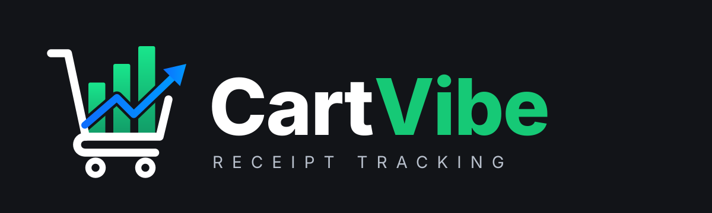
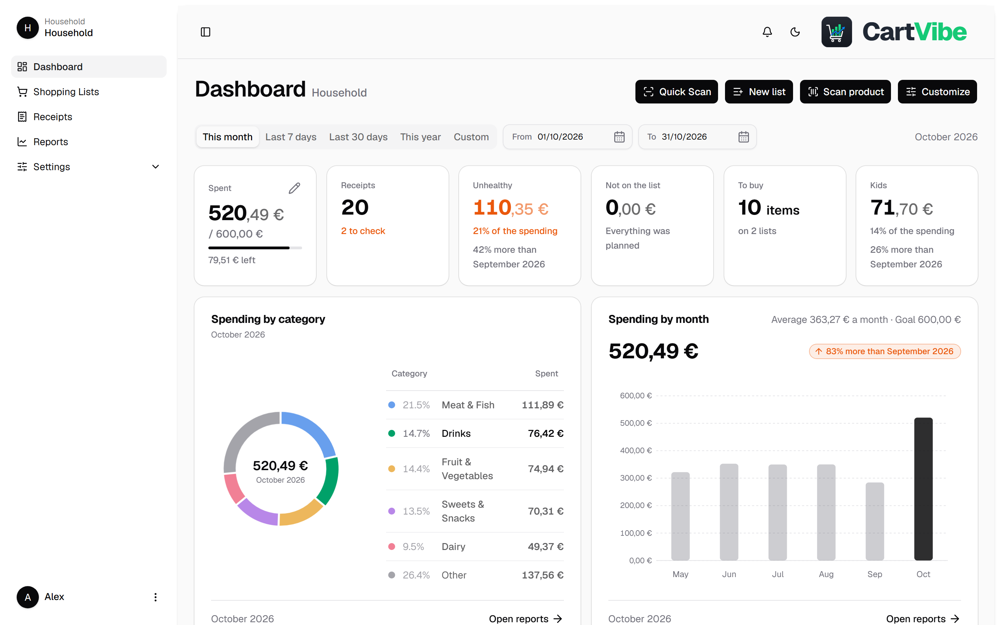
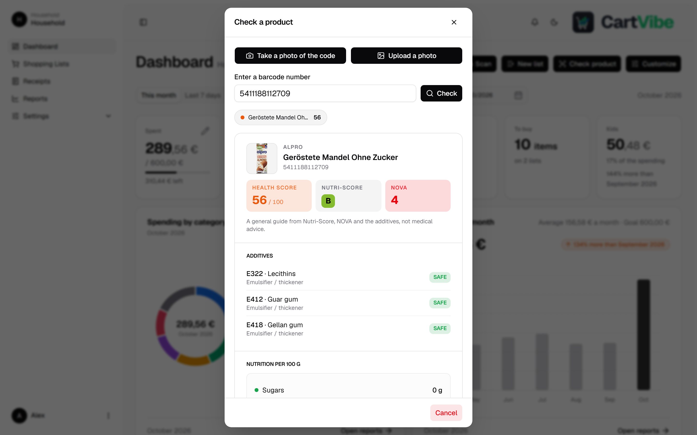
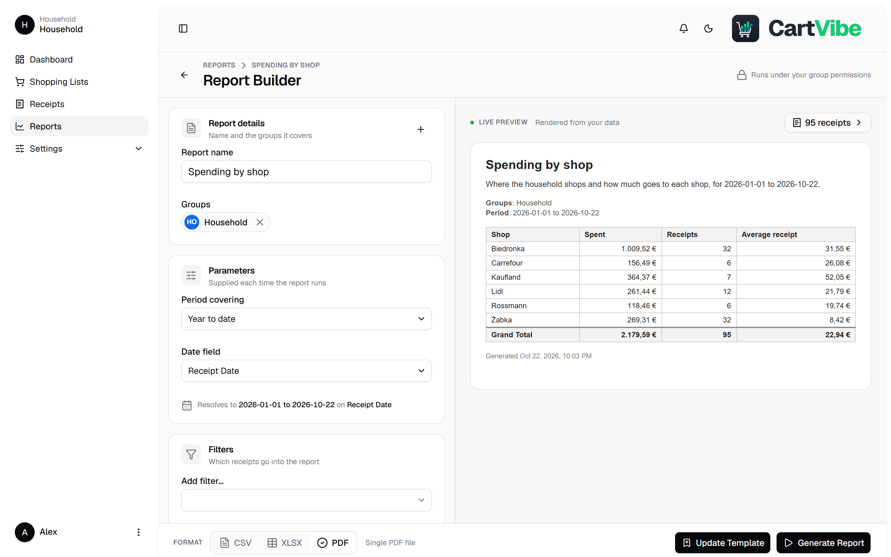
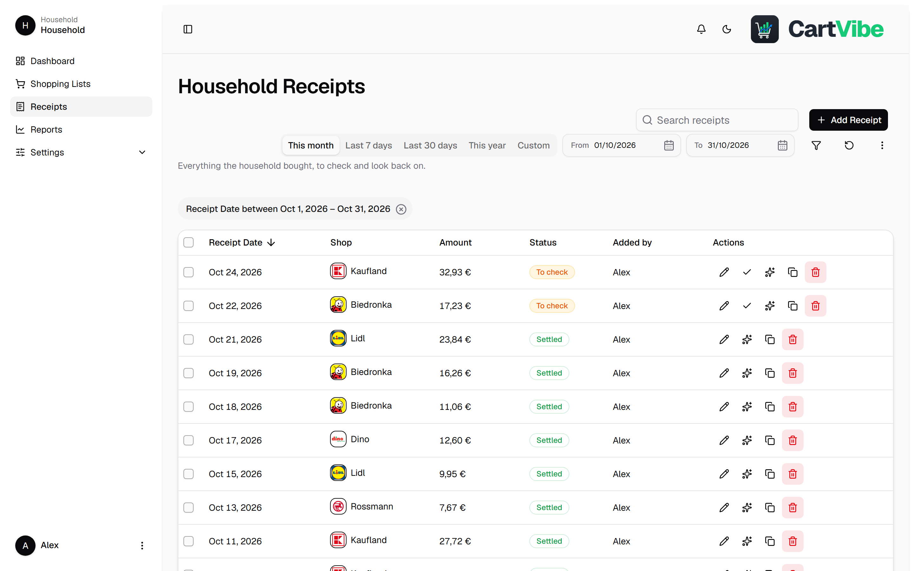
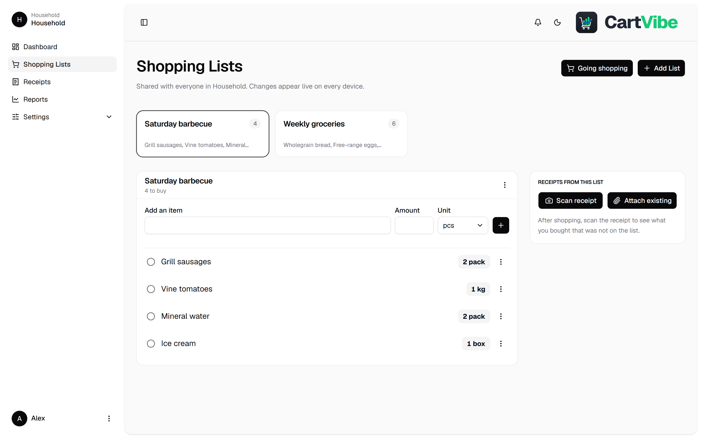
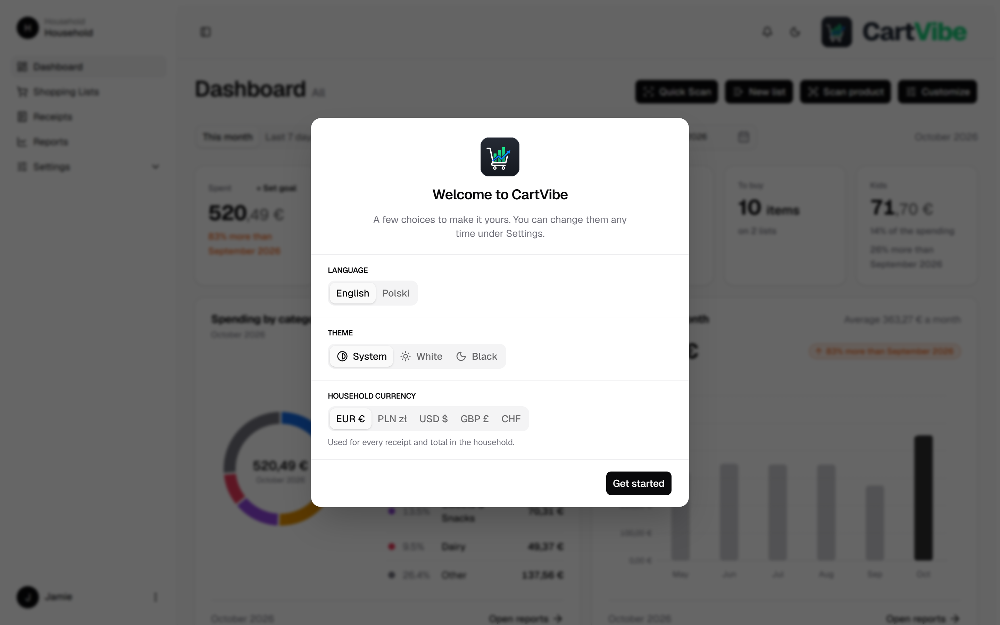
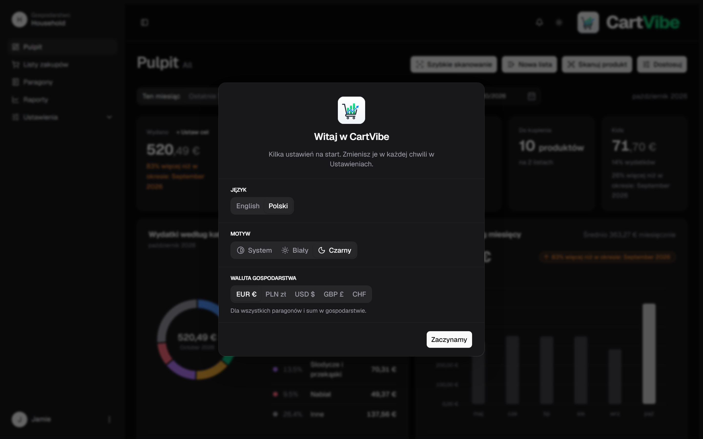

**CartVibe is a self-hosted household app for receipts, shopping lists and spending insights.**

[Project page](https://wouekk.github.io/cartvibe/) · [Quick start](#quick-start) · [Changelog](CHANGELOG.md) · [Credits](NOTICE.md) · [Issues](https://github.com/wouekk/cartvibe/issues)

---

> [!NOTE]
> **Credits.** CartVibe is a fork of [Receipt Wrangler](https://github.com/Receipt-Wrangler/receipt-wrangler) by
> [Noah Hall (@Noah231515)](https://github.com/Noah231515) and contributors, licensed under the AGPL-3.0. 
> This fork is a **vibe-coded** personal project: its changes were written with an
> AI assistant and are maintained by me for my household as a hobby project. Not affiliated with the original authors.
> Details in [NOTICE.md](NOTICE.md).

## Quick start

Requirements: [Docker](https://docs.docker.com/get-docker/) and Docker Compose (or a NAS stack manager such as Dockhand).

One image, built by GitHub Actions: `ghcr.io/wouekk/cartvibe` (`:latest` from `main`, `:preview` from a branch).
The root [docker-compose.yml](docker-compose.yml) is a complete stack (app + Redis + SQLite). Set `SECRET_KEY` and
`ENCRYPTION_KEY` (letters and digits only, no `$`), start it, and sign in with the default `admin` / `admin` **and change that
password immediately**. To update, pull the new image and redeploy.

## Features

| Feature | Description |
| :--- | :--- |
| **Family dashboard** | See what the month cost, how it compares with last month and how close you are to your goal. Drag the panels around until it feels right. |
| **Receipts read by AI** | Snap a photo and the AI fills in the shop, the total and every line on the receipt. Bring your own Gemini key, or run a model at home with LM Studio. |
| **Shops at a glance** | Logos for around 230 chains (Biedronka, Żabka, Lidl, Kaufland, Rewe and more), so you can spot a receipt without reading it. |
| **Healthy or not** | Healthy and unhealthy products are tagged based on the AI's assessment, and fruit and veg are marked as seasonal or imported. |
| **Product lookup** | Standing in the aisle? Scan or type a barcode to see the Nutri-Score, how processed it is, the additives and the nutrition, straight from Open Food Facts. Your last scans stay one tap away. |
| **Reports** | Slice your spending by shop, category, tag, health or month, watch the preview change as you go, and download it as CSV, Excel or PDF. |
| **Shared shopping lists** | One list for the whole household, updated live on every phone. Crossed-off items come back the next time you need them. |
| **Planned vs unplanned** | Attach a receipt to a list and see exactly what ended up in the basket that wasn't on it. |
| **Made for a household** | No bill splitting and no approvals: a receipt is either "to check" or "settled", and there are just two roles, Admin and User. |
| **Themes** | Light or dark, or simply follow your device. Built for the phone first. |
| **Languages** | Polish and English language support, chosen by each person. |

  <picture>
    <source media="(prefers-color-scheme: dark)" srcset="docs/screenshots/dashboard-dark.png" />
    
  </picture>
   
  <b>The family Dashboard</b>: what you've spent this month, how close you are to your goal, and where the money went

<table>
  <tr>
    <td width="50%" valign="top">
      
      
<b>Product lookup</b>: scan, upload or type a barcode; your recent scans stay one tap away

    </td>
    <td width="50%" valign="top">
      
      
<b>Reports</b>: see the result while you build it, then download it

    </td>
  </tr>
  <tr>
    <td width="50%" valign="top">
      
      
<b>Receipts</b>: shop logos, a search that forgives typos, and one date picker

    </td>
    <td width="50%" valign="top">
      
      
<b>Shopping lists</b>: shared and live, and one tap tells everyone you're heading to the shop

    </td>
  </tr>
  <tr>
    <td width="50%" valign="top">
      
      
<b>First sign-in</b>: pick a language, a theme and your currency

    </td>
    <td width="50%" valign="top">
      
      
<b>Polski i ciemny motyw</b>: the whole app in Polish or English, light or dark

    </td>
  </tr>
</table>

Screenshots show demo data.

## Repository layout

| Folder | What |
|---|---|
| `api/` | Go API (Chi, GORM, Asynq) |
| `desktop/` | Angular web app (the UI that ships, mobile-friendly) |
| `docker/` | The single image: nginx in front of the API |
| `docs/` | Design notes |
| `site/` | The project page |

Working notes for contributors and AI agents: [CLAUDE.md](CLAUDE.md), [AGENTS.md](AGENTS.md), [HANDOFF.md](HANDOFF.md).

## Versions

[Semantic Versioning](https://semver.org/). Changes are listed in [CHANGELOG.md](CHANGELOG.md); releases are tags
`vMAJOR.MINOR.PATCH` on `main`. Commit messages follow [Conventional Commits](https://www.conventionalcommits.org/).

## Licence

GNU Affero General Public License v3.0, as the original ([LICENSE](LICENSE)). If you run a modified copy as a
service, you must offer its users the source.
